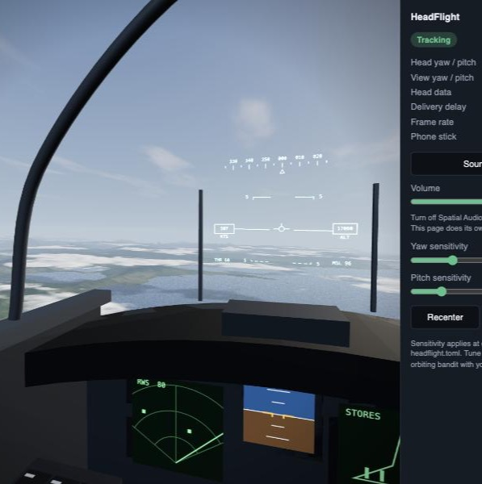

# HeadFlight

Fly a fighter in your browser with the hardware you already own. Your AirPods track your head, your iPhone is the flight stick, and your Mac runs the sim.

No camera, no IR clip, no phone app, and no game to install.



- **Look around by turning your head.** The motion sensors in your AirPods steer the view, with prediction to hide their 25 Hz update rate.
- **Fly with your iPhone.** Hold it upright like a stick. It connects by scanning a QR code, right from Safari.
- **Hear where things are.** Aircraft and warnings are placed in 3D and move as your head turns. The radio tells you where the bandit is, then you turn to find it.

Everything you see and hear is generated: terrain, clouds, aircraft, instruments, and engine sound.

## What you need

- A Mac on macOS 14 or later, with Swift (Xcode or its command line tools) and Python 3.11 or later
- AirPods that support head tracking, connected to the Mac
- An iPhone on the same Wi-Fi as the Mac

Tested on a MacBook Air (M2) with macOS 15.5, AirPods Pro, and an iPhone.

## Run it

```bash
./run.sh
```

The first run builds the AirPods sender and generates the radio voices. Then:

1. Allow **Motion & Fitness** access when macOS asks. The simulator opens in your browser.
2. Scan the QR code with your iPhone camera and open the link.
3. Safari warns about the certificate because your Mac made it. Tap **Show Details**, then **visit this website**.
4. Press **Start** and allow motion access. Hold the phone the way you will fly it first, since that position becomes center.
5. Click anywhere in the simulator to turn on sound, and turn off Spatial Audio for your AirPods so head tracking isn't applied twice.

Press Ctrl+C in the terminal to stop.

## Flying

Hold the phone upright in your right hand, with the side button toward you and the volume buttons away.

| Move | Result |
|---|---|
| Tilt back toward you | Nose up |
| Tilt away from you | Nose down |
| Tilt left or right | Roll |
| Swipe up or down on the screen | Throttle |
| Turn your head | Look around |

Three aircraft are there to look at. One orbits you, so following it takes your full range of movement. Your wingman holds formation off the right wing, and a third flies high and far away for testing fine control.

Listen for the radar warning: it comes from the bandit's direction. Put the bandit in the middle of your view to hear the seeker tone, and hold it there for your wingman to call it out.

The sliders in the simulator set yaw and pitch sensitivity. They apply at once and are saved to `sim/headflight.toml`. Everything else is documented in `sim/headflight.example.toml`, and saving your copy applies at once too.

## How it works

```
AirPods ──CoreMotion──> sender (Swift) ──UDP──> server (Python) ──> browser (Three.js, Web Audio)
                                                     ^
iPhone ──motion sensors──> Safari ──HTTPS────────────┘
```

**Head tracking.** AirPods report orientation 25 times a second, and those samples reach the Mac in bursts. A plain passthrough would look late and steppy. So the sender stamps each packet with the sensor's own clock and a gyro rate, and the server uses them to work out where your head is right now, 120 times a second. Corrections fade in rather than snapping the view.

**Phone stick.** iOS only gives motion sensors to HTTPS pages, so the server makes a self-signed certificate and serves the stick page over your LAN. Tilt is measured relative to the position you started in, as a rotation rather than Euler angles, so the axes stay independent even with the phone upright, where Euler angles break down.

**Sound.** The listener follows the view and your real head together, using HRTF panning in Web Audio. A sound stays on the screen when you glance away from it, which keeps what you see and hear in agreement.

## Measurements

Taken on the tested hardware from recordings of real head movement.

| | |
|---|---|
| Sensor rate | 25 Hz, 40 ms apart, no lost packets |
| Delivery delay above the fastest sample | median 30 ms, worst 96 ms |
| Noise with the head still | 0.08 degrees |
| Gyro rate against actual movement | correlation 1.000, gain 1.01 |
| Error predicting 40 ms ahead while moving | down 89%, from 3.3 to 0.4 degrees |
| Compared with plain passthrough | 56 ms ahead, 20 times smoother |

Delays are relative to the fastest sample seen. The fixed delay between the sensor and the Mac can't be measured this way, so these are not end-to-end latency figures.

## Project layout

| Path | What it is |
|---|---|
| `sender/` | Reads AirPods motion on the Mac and streams it. A fork of [AirTracker](https://github.com/crippler95/airtracker). |
| `sim/headflight/` | The server: prediction, head-to-view mapping, phone stick, QR codes. |
| `sim/headflight/web/` | The simulator page, the 3D cockpit, the sound engine, and the phone page. |
| `sim/tests/` | Tests. Run with `cd sim && python3 -m unittest discover -s tests`. |

No AirPods handy? `python3 -m headflight record trace.csv` saves a head trace, and `python3 -m headflight replay trace.csv --loop` plays it back. Run them from `sim/`.

## Limitations

- This is a demo. The flight model is simple and arcade-like, and there are no weapons, landings, or low-level flight: the world is only drawn from above 3,900 m.
- The phone stick assumes the right-hand grip described above.
- Sound lags the picture a little because of Bluetooth, so sound direction trails a fast head turn.
- Generic HRTF varies from person to person. Front and back are the easiest to confuse, and a small head turn settles it.
- Head tracking drifts slowly. It corrects itself while you look at the screen, and **Recenter** fixes it at once.

## Credits

- [AirTracker](https://github.com/crippler95/airtracker) by crippler95 (MIT) is the base of the sender.
- [Three.js](https://threejs.org) (MIT) renders the cockpit.

## License

MIT. See [LICENSE](LICENSE). `sender/` keeps its original MIT license in [sender/LICENSE](sender/LICENSE).

Not affiliated with or endorsed by Apple. AirPods and iPhone are trademarks of Apple Inc.
